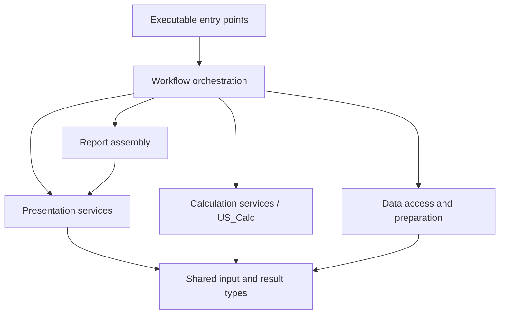

# Ending circular dependencies in analysis and reporting

Initial analysis: 2026-11-13. Based on `calc-library-extraction` at
`29e9a70995a7727c718c90a2334fe711f09342d6`. This document proposes further
separation; it does not claim that the cycles have been removed.

## What already helps: the calculation extraction

The calc branch provides a usable lower-level calculation boundary. Reuse it
instead of starting another calculation library:

- `utils/us_calc_*.{h,cpp}` implement `US_Calc` with QtCore value types, without
  widgets, database access, file reading or report formatting.
- The GMP reporter calls `range_summary`, `model_means`, `replicate_summary`,
  `passes` and `method_matches`. `US_Model::calc_model()` supplies the calculation
  representation. Selection of report inputs and formatting remain in the caller.
- Results carry diagnostics and algorithm versions. The current API uses NaN
  plus diagnostics for undefined values and remains C++14 compatible; earlier
  commits using `std::optional` are not the current design.
- `test/calc` supplies fitted-model and edge fixtures, an independent Python
  oracle, calculation tests, and legacy GUI comparisons. Preserve component
  order, units, range-bound inclusivity and tolerance semantics during extraction.
  `utils/CMakeLists.txt` also specifies floating-point contraction handling.

Useful history: `8fd2b8428` migrated reporter arithmetic, `6fb3ee0f0` moved
calculations into `us_utils`, and `0a1f9c857` established the current C++14 result
handling. Logical separation does not require a separate binary library:
`US_Calc` now lives inside the existing utilities library.

This reduces the arithmetic that remains trapped in the reporter and supplies
a regression approach for further extraction. It does **not** remove the
residual-plot back-dependencies or reciprocal source aggregation. Those files
are unchanged between the inspected build-issues and calc branches. Simulation,
residual preparation, data selection, plotting and workflow sequencing still
need their own boundary review.

## Observed coupling

Here, “reporter” means `us_reporter_gmp`, not the separate `us_reporter` program.

| Evidence | Architectural consequence |
|---|---|
| The CMake files in `programs/us_autoflow_analysis`, `programs/us_fematch` and `programs/us_reporter_gmp` compile one another's implementation sources. | Creating one library per directory would retain reciprocal dependencies. Current source aggregation is not itself a cycle between linked CMake library targets. |
| `programs/us_fematch/us_resplot_fem.cpp` includes all three application headers. Its constructor casts `parent` to `US_FeMatch`, `US_Analysis_auto` or `US_ReporterGMP`, selected by an empty mode string, `ANALYSIS` or `REPORT`. | A reusable presentation component depends on its application owners. QWidget ownership is also being used as a data interface. |
| Autoflow and reporter headers include `../us_fematch/us_fematch.h`. | The return dependency exists in public application headers as well as source lists. |
| The plot constructor retrieves edited/simulated data, excluded scans, TI/RI noise and a bitmap pointer through three parallel accessor families, plus triple information for automated modes. | Explicit plot inputs can replace knowledge of all three concrete owners. |
| The plot creates, updates and closes `US_ResidsBitmap` windows. | Bitmap lifetime belongs in the presentation design; it must not leak into a calculation result. |

These are confirmed starting edges, not a complete include or symbol graph.
The source lists also aggregate editing, 2DSA, analysis profiles, distributions
and other programs. Their dependencies must be checked before claiming a full split.

## Proposed service boundaries

| Boundary | Inputs and outputs | Placement and remaining work |
|---|---|---|
| Calculation | Models, explicit numeric parameters and selection masks → numeric results and diagnostics | Extend `US_Calc` where appropriate. Audit `calc_residuals`, simulation setup and numerical loops in `plot_edata`/`plot_rdata`; do not move widgets or database policy with the arithmetic. Simulation workers may require a separate execution service around existing numerical engines. |
| Data access and preparation | Run/triple/edit identifiers and explicit selection policy → validated edited/raw data, models, noise and provenance | Build on `programs/us_edited_data_loaders.{h,cpp}` and `IUS_DB2`. Its `loadAutoflow` and `loadReporter` deliberately retain different selection rules; do not silently unify them. Keep I/O outside calculations. |
| Presentation | Prepared curves/residuals, labels and explicit display options → plots, bitmap views and export artifacts | Extract residual presentation from application ownership. Rendering can depend on Qt Widgets/Qwt; calculations cannot depend on rendering. |
| Report assembly | Calculated results, metadata and rendered artifacts → report content | Separate formatting from acquisition and simulation. The report workflow decides what to load and calculate. |
| Workflow orchestration | User/protocol requests → coordinated acquisition, calculation, presentation and persistence | Keep sequencing, cancellation, progress, retries and application state above the services. Autoflow and reporter must not be dependencies of those services. |

Desired dependency direction (arrows mean “depends on”):

The diagram describes logical boundaries, not a requirement to introduce six
libraries. Shared types must not include application headers. Existing domain
types can be reused where they satisfy that restriction.

## First concrete cycle-breaking change

Replace `US_ResidPlotFem`'s owner discovery with an explicit input contract.

1. Inventory constructor call sites and the three accessor families. Specify
   edited/simulated data, exclusions, noise and triple labels as explicit inputs.
   Specify report display/export behavior independently of the owner's class.
2. Keep `QWidget* parent` solely for Qt ownership. Have each application assemble
   the input contract; remove mode-based casts and all three application includes
   from the plot implementation.
3. Decide data lifetime before implementing the contract. For an initial borrowed
   view, owners must keep buffers stable while the dialog is alive and close or
   refresh it before replacement. Snapshot ownership may be preferable for
   asynchronous reporting, but its memory cost needs measurement.
4. Keep bitmap ownership in the presentation layer, with explicit notification
   if callers need it. Preserve destruction, reopen and close behavior.
5. Verify manual FEMatch, autoflow analysis and report rendering. This removes
   the known upward dependency; then inspect remaining references before removing
   CMake source entries. Forward declarations alone do not resolve the cycle.

## Staged implementation and acceptance

1. **Build on calc.** Stack this work on `calc-library-extraction`. Preserve its
   tests and documented numerical exceptions. Review integration separately from
   unrelated build/platform changes already on that branch.
2. **Record the baseline.** Inventory includes, symbols and callers across the
   aggregated programs. Capture representative numerical and report outputs,
   link maps and source membership before extraction.
3. **Remove the plot back-edge.** Implement the explicit input contract above.
   Test exclusions, TI/RI noise combinations, absent data, report plotting and
   dialog/bitmap lifetime. Verify a presentation target can compile without
   autoflow, FEMatch or reporter application include paths.
4. **Extract remaining services incrementally.** Separate residual arithmetic,
   simulation execution and report assembly in reviewable changes. Keep loading
   selection and report eligibility decisions explicit. Reuse calc fixtures and
   add coverage for newly extracted behavior; do not regenerate expectations just
   to make changed scientific results pass.
5. **Assign source ownership.** Only after dependencies point downward, assign
   implementations to targets, keep executable mains separate, give Qt moc inputs
   one owner, and replace repeated source lists with explicit target links.
   Check all consumers, including programs outside the three initial directories.
6. **Enforce the boundary.** Add focused checks rejecting application includes in
   lower-level services and cycles among intended library targets. Build the
   affected executables and test normal and failure paths on supported platforms.

A temporary internal combined library may own the still-coupled implementation
sources once, reducing repeated compilation. Name and document it as transitional,
keep entry points outside it, and record the remaining edges. A successful link,
fewer compilation units, or hiding a cycle inside one target is not completed
separation. Link groups and broad public include directories are not substitutes
for removing upward dependencies.

Completion means lower-level calculation, data and presentation components can
be used and tested without constructing workflow widgets; the known parent casts
are gone; source ownership is explicit; the intended target graph is acyclic;
and numerical behavior, reporting and workflow behavior have been verified.

## Verification status and next investigation

This initial document is based on source and Git-history inspection. No build or
calculation tests were run for this documentation change. The presence of the
calc tests is evidence of available coverage, not a claim of a fresh passing run.

Next, enumerate residual-dialog callers and ownership assumptions; compare the
three `calc_residuals` paths; trace simulation worker dependencies; and identify
which report eligibility and provenance rules must remain in orchestration.
Re-run `ctest --test-dir <build> -L calc --output-on-failure` and the oracle checks
when validating implementation changes on the stacked branch.
